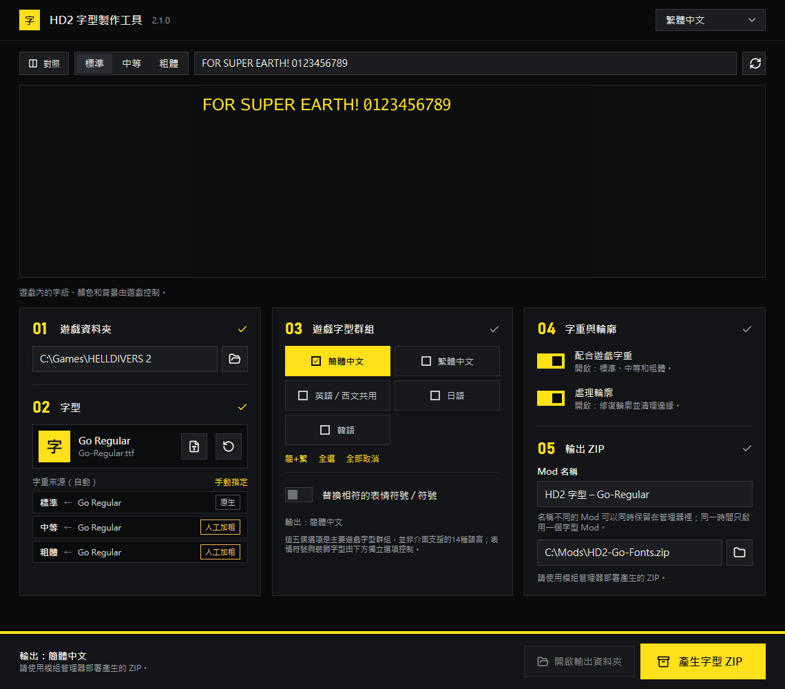

<p align="center"><a href="README.md">简体中文</a> | <a href="README.zh-TW.md">繁體中文</a> | <a href="README.ja.md">日本語</a> | <a href="README.ko.md">한국어</a> | <strong>English</strong></p>

<p align="center">
  
</p>

<h1 align="center">HD2 Font Maker</h1>

<p align="center">
  Build a Helldivers 2 font replacement mod from your own font.<br>
  Native Windows app · 14 interface languages · No Python required
</p>

<p align="center">
  <a href="https://github.com/cainiao524/hd2-font-maker-go/releases/latest"></a>
  <a href="LICENSE"></a>
  
</p>

<p align="center">
  
</p>

## Download

Download `HD2-Font-Maker-<版本>-Windows.zip` (about 14 MB) from the [latest Release](https://github.com/cainiao524/hd2-font-maker-go/releases/latest). `<版本>` is the version number.

- Extract the whole folder to a writable location outside the game directory, then run `HD2FontMaker.exe`.
- Keep the DLLs and the `vendor` folder that sit beside the EXE.
- You do not need to install Python, Go, or WebView.

2.2.6 puts Simplified Chinese, Traditional Chinese, Japanese, Korean, and English in the default preview, and keeps each other interface language's own slogan first. A saved copy of any previous default sample is replaced; text you edited yourself stays. READMEs are published in Simplified Chinese, Traditional Chinese, Japanese, Korean, and English. Font generation rules are unchanged. This build was not run on a real Windows desktop, and the CJK preview lines were not checked with a font that contains those outlines. In-game display is still unverified.

2.2.5 updates the build toolchain to Go 1.27.4 (the 2026-11-10 security release) and the UI framework to MyGo 0.9.1. Weights, outlines, atlas parameters, and packaging rules are unchanged, so an existing font mod does not need to be regenerated for this upgrade. The window keeps its yellow accent when it loses focus. While a mod is generating, the steps area fades as one group. In-game display is still unverified.

2.2.4 supports selecting several font files by hand, or dropping them in together, and matches same-family weights only among the files you selected. The file list and manual assignments are saved with the settings and restored after a restart. Selecting a single file again clears the previous batch. Automatic scanning of the same folder stays off. The gentler bolding fix from 2.2.3 is kept.

2.2.3 turns off automatic scanning of fonts in the same folder: only the files you selected are imported, and external fonts stored in older settings are removed on load. Weights inside a TTC/OTC collection still match automatically. Renamed copies no longer enter multi-weight mode by mistake, and synthetic bolding is reduced so strokes at small sizes stick together less. The font mod has to be regenerated for the fix to apply.

2.2.2 adds "Imported font weight". A single static font is used as Medium (500) by default, and the lighter weight and Bold are generated automatically. You can also choose Regular (400) and have Medium and Bold produced by synthetic bolding, or choose Bold (700). The anchor you pick is saved with the font, and each weight step is generated independently from the imported font. When a collection already has same-family Regular, Medium, and Bold faces, those faces are matched automatically. MyGo 0.7.4 and Go 1.27.3 are updated in the same release. The font mod must be regenerated before the fix applies. Existing users can keep `UserData`. Per-glyph failure fallback and counting from 2.2.1 are kept.

2.1.2 fixes generation progress that stayed on “—%”. Overall progress advances by how much of each stage is finished, and it reaches 100% only after ZIP verification succeeds. Existing users can keep `UserData`.

2.1.1 fixes same-family fallback atlases that did not match the font file they came from, and fixes the family and manual weights being lost when a font is imported again or restored from cache. Existing users can keep `UserData`. If an older configuration incorrectly included a variable same-family member, import the font once more from its original directory. The atlas fix takes effect only after the font mod is regenerated.

## Usage

1. Choose the Helldivers 2 install directory, or its `data` folder.
2. Choose or drop in TTF, OTF, TTC, or OTC fonts. Ctrl/Shift multi-select and dropping several files at once are both supported. Same-family weights are matched only among the files you selected; other fonts in the same folder are not scanned. Inside a font collection, faces can be matched automatically, or you can pick a specific face.
3. Choose the game font groups to replace: Western, Simplified Chinese, Traditional Chinese, Japanese, and Korean. Add emoji and special symbols if you need them.
4. Turn "Match game font weights" and "Process outlines" on or off as needed. For a single font, use "Imported font weight" to select the weight that font actually is. The default is Medium. If you only have the lighter face, choose "Regular (400)". Same-family weights in the selected files and inside a collection are matched automatically, and you can assign a source by hand on each row. At the top you can switch the preview weight and compare it with the original game font.
5. Enter a mod name and an output ZIP, then click "Generate font ZIP". The default name follows the font family and stays after you edit it. The bottom of the window lists what is still missing before generation.
6. Install the generated ZIP with a mod manager.

The program only reads the game directory you selected. It does not launch the game, inject into it, or modify it, and it does not install the mod for you. The interface language affects only the interface. It does not change what is generated.

## Features

- **Full replacement**: Keeps the source font's complete character set and supports mixed Simplified and Traditional Chinese. In same-family multi-weight mode, missing glyphs are filled from the other selected faces first, then fall back to the original game font.
- **Weight matching**: When the selected files or a collection contain several faces of the same family, the matching native weight is chosen automatically. Synthetic bolding covers only the weight gap that is still missing. Variable fonts use their own weight axis. A single static font defaults to Medium (500). You can choose Regular (400) or Bold (700) instead. The step you choose is used as-is, and the other steps are generated automatically. Any row can also be set back to the original by hand.
- **Outline processing**: Repairs outlines and cleans edges. It is switched separately from weight matching.
- **Format preserved**: Keeps the target font's TTF/CFF format, its units per em (UPM), and the original game font's family and style registration.
- **Atlas output**: Generates an RGBA MTSDF atlas and every mip level.
- **Native components**: A Go engine plus a native [MyGo](https://github.com/egoist/mygo) interface. Skia, HarfBuzz, and msdf-atlas-gen are included in the package.
- **Interface**: A fixed dark theme with a yellow accent, a comparison preview, a layout that switches between one and three columns as the window width changes, generation progress, and a completion panel. It supports 14 interface languages.
- **Mod name**: The name is part of the generated package's identity. Different names can be kept separately in the manager. You should still enable only one font mod that replaces the same resources at a time.

## Notes

- 2.2.6 has not been tested in-game and was not run on a real Windows desktop. The CJK lines in the preview were not checked with a font that contains those outlines. Output from single-font weight matching is intentionally no longer byte-for-byte identical to 2.0.0. Historically, 2.0.0 was confirmed to display correctly on game version 01.007.200 in the Simplified Chinese, Traditional Chinese, and Japanese interfaces. That result does not speak for 2.2.6. This version does not fix font-engine problems: a font-structure error that cannot fall back safely still fails, and a native outline operation that fails on a single glyph still falls back that glyph and continues, as in 2.2.1.
- When synthetic weights hit a native outline error on a single glyph, that glyph is fallen back and generation continues. If a font table, a glyph encoding, or the whole file cannot fall back safely, the build still reports failure.
- Font copyright stays with the original authors. Use only fonts you have the right to use, and share a generated mod under that font's license.
- The release package and the source do not contain any personal fonts, game fonts, game assets, or pre-generated font mods.

## Validation

The validation notes are written in Simplified Chinese.

The 2.2.6 preview sample, the translated READMEs, and the real-Windows and in-game checks that were not done are covered in [VALIDATION-2.2.6.zh-CN.txt](VALIDATION-2.2.6.zh-CN.txt).

The 2.2.5 toolchain and MyGo upgrade, and in-game display that is still unverified, are covered in [VALIDATION-2.2.5.zh-CN.txt](VALIDATION-2.2.5.zh-CN.txt).

Multi-select import, multi-file drop, restart restore, and native weight-preview checks for 2.2.4 are in [VALIDATION-2.2.4.zh-CN.txt](VALIDATION-2.2.4.zh-CN.txt).

Import scope, migration of old settings, gentler bolding, and native generation checks for 2.2.3 are in [VALIDATION-2.2.3.zh-CN.txt](VALIDATION-2.2.3.zh-CN.txt).

Single-font anchor selection, automatic collection matching, the MyGo upgrade, and preview/generation regression checks for 2.2.2 are in [VALIDATION-2.2.2.zh-CN.txt](VALIDATION-2.2.2.zh-CN.txt). Synthetic-weight fallback, the Windows build, and the unfinished in-game check for 2.2.1 are in [VALIDATION-2.2.1.zh-CN.txt](VALIDATION-2.2.1.zh-CN.txt). The single-font weight change, thinning fallback, and the unfinished Windows / in-game checks for 2.2.0 are in [VALIDATION-2.2.0.zh-CN.txt](VALIDATION-2.2.0.zh-CN.txt).

Progress regression, generation from real assets, the source-package rebuild, and the validation boundary for 2.1.2 are in [VALIDATION-2.1.2.zh-CN.txt](VALIDATION-2.1.2.zh-CN.txt).

Same-family font regression, native atlas generation, the source-package rebuild, and items left unverified for 2.1.1 are in [VALIDATION-2.1.1.zh-CN.txt](VALIDATION-2.1.1.zh-CN.txt). Historical notes, including the 2.1.0 single-font compatibility comparison, are in [VALIDATION-2.1.0.zh-CN.txt](VALIDATION-2.1.0.zh-CN.txt).

Compared with the original 1.3 implementation (frontend 1.3.0 / engine 1.3.7): for both test fonts, every mip level of all 13 atlases matches byte for byte. Shaping, glyph geometry, advance, and cmap comparisons show no differences.

<details>
<summary>1.3.0-go.1 baseline validation</summary>

The final cold generation did not use a cache of results that had already been generated. All five main font groups and the symbols were on, and both weight matching and outline processing were on. Test font A took 66.961 seconds, and test font B took 114.517 seconds. The figures above are a single observation on this machine, not a statistical baseline. They do not include font import or the first scan of the game's font inventory.

Each of the two outputs contains 13 atlases. Every mip level matches the original 1.3 implementation byte for byte. Combined atlas GPU load is about 448 MiB per output, and the largest single atlas is 4096×2048.

Each output passed 1,360 shaping checks and 1,972 emitted-geometry pair checks. The advance difference is 0. Missing cmap entries and extra cmap entries are both 0.

Full font audit: test fonts A and B each covered 36 resource slots and 17 deduplicated font pairs, checking 1,957,145 and 2,109,193 codepoints respectively. After an exact review of the empty records, no semantic item was left unresolved.

In a few glyphs that already contain ink, the 1.3 CFF output also includes empty move/close contours that have no drawing commands. The Go output may omit those empty contours. An independent review accepts only this encoding difference, and confirms that every other drawing command matches exactly once closed edges are normalized. A zero-area path that still has a drawn edge, or a change in contour direction or signed area, is still treated as a failure. GID, table compression, the font's binary layout, and metadata may differ. The font files themselves are not byte-for-byte identical.

</details>

Full records: [VALIDATION-1.3.0-go.1.zh-CN.txt](VALIDATION-1.3.0-go.1.zh-CN.txt) (baseline) and [VALIDATION.zh-CN.txt](VALIDATION.zh-CN.txt) (the 1.3.0-go.2 fix for Chinese paths). Changes in each version are listed on [Releases](https://github.com/cainiao524/hd2-font-maker-go/releases).

## Build from source

Windows x64 is required. This version is built and verified with Go 1.27.4.

```powershell
.\build.ps1 -Go '<go.exe 路径>' -Test
```

The script runs the MyGo module tests, produces `native_go/mygoapp/bin/HD2FontMaker.exe`, and copies the native DLLs from `native_go/bin` and the atlas tools from the root `vendor/` folder next to the EXE. `<go.exe 路径>` is a placeholder for the path to go.exe. Run the full test suite with `.\test.ps1 -Go '<go.exe 路径>'`.

Build the Windows portable package, the source package, and the SHA-256 manifest on your machine with `.\package.ps1 -Go '<go.exe 路径>'`. It runs the full tests first by default. If you have just finished the tests, add `-SkipBuild` to reuse the build you already have. The script still checks the version and the ZIP contents. Output goes to `dist/`.

- `native_go/`: the font engine (Go module `hd2font/native`).
- `native_go/mygoapp/`: the MyGo interface (a nested module). Interface translations are in `locales/`.
- Rebuilding the optional native Skia/HarfBuzz libraries is described in [native_go/SOURCE_BUILD.txt](native_go/SOURCE_BUILD.txt).

## English

HD2 Font Maker builds a Helldivers 2 font replacement mod from a font you supply. It is a native Windows app (Go engine, MyGo UI, 14 interface languages) that reads the game folder read-only and writes a ZIP for your mod manager. Download published Windows builds from [Releases](https://github.com/cainiao524/hd2-font-maker-go/releases/latest); build from source with `.\build.ps1 -Go '<path-to-go.exe>' -Test`. Version 2.2.6 puts Simplified Chinese, Traditional Chinese, Japanese, Korean, and English in the default preview sample, keeps each other interface language's own slogan first, and replaces a saved copy of any previous default. Custom preview text is left unchanged. READMEs are published in those five languages. This build was not run on a real Windows desktop, and the CJK preview lines were not checked with a font that contains those outlines. Version 2.2.5 updates the toolchain to Go 1.27.4 (security release, 2026-11-10) and the UI framework to MyGo 0.9.1. Weight synthesis, outline processing, atlas parameters and packaging rules are unchanged, so an existing font mod does not need to be regenerated for this upgrade. The window keeps its yellow accent when inactive. While a mod is generating, the steps fade as one group. Selecting or dropping multiple files still matches compatible weights only within that explicit selection. The selection and manual assignments survive restarts. Importing one file replaces the previous batch. Neighboring files are never scanned; internal TTC/OTC faces still match automatically. Synthetic emphasis stays at the gentler 2.2.3 curve, and identical copies do not trigger family-based extra bolding. The app defaults lone static fonts to Medium (500), with a saved choice of Regular (400), Medium (500), or Bold (700). Collections with native Regular, Medium and Bold faces match automatically. In-game rendering has not been verified. Per-glyph fallback for a native path failure is unchanged from 2.2.1; a font structure that cannot fall back safely still fails the build. Single-font output remains intentionally different from 2.0.0.

## License

The project's own code is under the [MIT License](LICENSE). Third-party components keep their own licenses and notices. See [native_go/THIRD-PARTY-NOTICES.txt](native_go/THIRD-PARTY-NOTICES.txt) and [native_go/LICENSES](native_go/LICENSES).

The other language versions sit in the same directory. When you update this page, change `README.md`, `README.zh-TW.md`, `README.ja.md`, `README.ko.md`, and `README.en.md` together.
