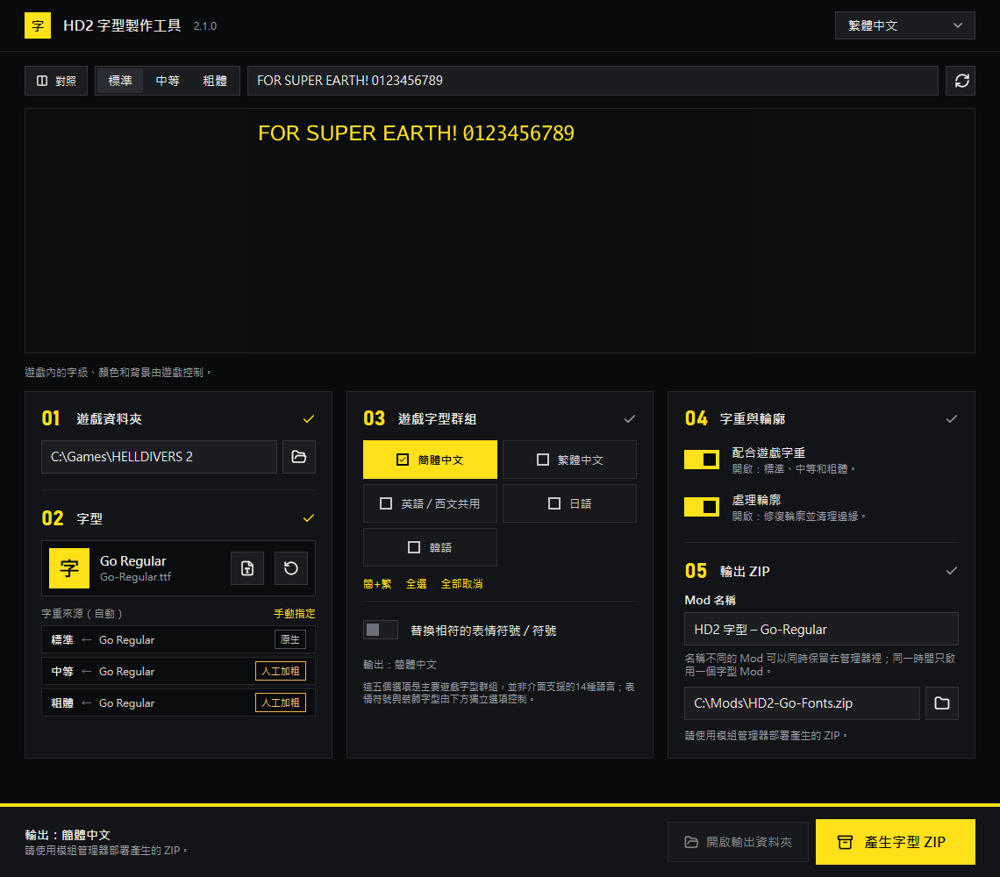

<p align="center"><a href="README.md">简体中文</a> | <a href="README.zh-TW.md">繁體中文</a> | <strong>日本語</strong> | <a href="README.ko.md">한국어</a> | <a href="README.en.md">English</a></p>

<p align="center">
  
</p>

<h1 align="center">HD2 Font Maker</h1>

<p align="center">
  自分のフォントで、ヘルダイバー2 のフォント置換 Mod を作ります。<br>
  Windows ネイティブアプリ · 表示言語 14 種類 · Python 不要
</p>

<p align="center">
  <a href="https://github.com/cainiao524/hd2-font-maker-go/releases/latest"></a>
  <a href="LICENSE"></a>
  
</p>

<p align="center">
  
</p>

## ダウンロード

[Releases の最新版](https://github.com/cainiao524/hd2-font-maker-go/releases/latest)から `HD2-Font-Maker-<版本>-Windows.zip`（約 14 MB）をダウンロードします。`<版本>` はバージョン番号です。

- フォルダー一式を、ゲームのディレクトリ以外で書き込める場所に展開し、`HD2FontMaker.exe` を実行します。
- EXE と同じ場所にある DLL と `vendor` フォルダーは残してください。
- Python、Go、WebView をインストールする必要はありません。

2.2.6 の既定プレビューには、簡体字中国語、繁体字中国語、日本語、韓国語、英語の標語と、従来の `Player G4 - 0123456789` が入ります。それ以外の表示言語では、その言語の標語を先頭に残します。保存されていた旧い既定文は自動で新しい文に替わり、自分で書き換えた文はそのままです。説明は簡体字中国語、繁体字中国語、日本語、韓国語、英語で公開しています。フォント生成の規則は変わっていません。このビルドは実際の Windows では動かしておらず、中日韓の字形を含むフォントでプレビューも確認していません。ゲーム内の表示は、まだ検証していません。

2.2.5 では、ビルドのツールチェーンを Go 1.27.4（2026-11-10 のセキュリティリリース）へ、UI フレームワークを MyGo 0.9.1 へ更新しました。ウェイト、アウトライン、アトラスのパラメータ、パッケージングの規則は変わっていません。既存のフォント Mod を、この更新のために作り直す必要はありません。ウィンドウがフォーカスを失っても、黄色のアクセントカラーはそのままです。生成中は、手順の領域がひとまとまりで薄く表示されます。ゲーム内の表示は、まだ検証していません。

2.2.4 では、フォントファイルを手動で複数選ぶか、まとめてドロップできます。同じファミリーのウェイトは、選んだファイルの中だけで割り当てます。ファイルの一覧と手動の割り当ては設定とともに保存され、再起動すると戻ります。ファイルをひとつだけ選び直すと、前のまとまりは消去されます。同じディレクトリの自動スキャンは、オフのままです。2.2.3 の穏やかな擬似太字の修正はそのまま残しています。

2.2.3 では、同じディレクトリにあるフォントの自動スキャンをやめました。選んだファイルだけを読み込み、古い設定に残っていた外部フォントは読み込み時に取り除きます。TTC／OTC コレクションの内部では、ウェイトの自動割り当てを続けます。名前を変えた複製が誤って複数ウェイトのモードに入る不具合を直し、擬似太字の強さを下げて、小さいサイズで字画がくっつくのを和らげました。修正を反映するには、フォント Mod を作り直す必要があります。

2.2.2 では「読み込んだフォントの太さ」を追加しました。静的フォントがひとつだけのときは、初期値として中太（500）を使い、細いウェイトと太字を自動で作ります。標準（400）を選び、擬似太字で中太と太字を作ることも、太字（700）を選ぶこともできます。基準にした選択はフォントとともに保存され、各段階は読み込んだフォントから独立して生成されます。コレクション内に同じファミリーの標準・中太・太字がすでにあるときは、対応する書体へ自動で割り当てます。あわせて MyGo 0.7.4 と Go 1.27.3 へ更新しました。修正を反映するにはフォント Mod を作り直す必要があります。これまでの利用者は `UserData` を残して構いません。2.2.1 の、グリフ単位で失敗したときのフォールバックと件数はそのままです。

2.1.2 では、生成の進捗が“—%”のままになる問題を直しました。全体の進捗は段階ごとの完了量に合わせて進み、ZIP の検証に成功してから 100% になります。これまでの利用者は `UserData` を残して構いません。

2.1.1 では、同じファミリーで字形を補ったアトラスが、元のフォントファイルと食い違う問題を直しました。フォントを読み込み直したとき、およびキャッシュから復元したときに、ファミリーと手動のウェイトが失われる問題も直しています。これまでの利用者は `UserData` を残して構いません。古い設定が可変フォントの同ファミリー書体を誤って含んでいる場合は、元のディレクトリからフォントを一度読み込み直してください。アトラスの修正は、フォント Mod を作り直すと反映されます。

## 使い方

1. ヘルダイバー2（Helldivers 2）のインストールディレクトリ、またはその `data` フォルダーを選びます。
2. TTF、OTF、TTC、OTC のフォントを選ぶか、そのままドロップします。Ctrl／Shift による複数選択と、複数ファイルの同時ドロップに対応しています。同じファミリーのウェイトは選んだファイルの中だけで割り当て、同じディレクトリの他のフォントはスキャンしません。フォントコレクションの内部でも、自動で割り当てるか、書体を直接選べます。
3. 置き換えるゲームのフォントグループを選びます。欧文、簡体字中国語、繁体字中国語、日本語、韓国語です。必要なら絵文字と特殊記号も追加します。
4. 「ゲームのフォントの太さに合わせる」と「アウトラインを処理する」は、必要に応じてオンまたはオフにします。フォントがひとつのときは、「読み込んだフォントの太さ」で、元のフォントに対応する太さを選びます。初期値は中太です。細い書体しかないときは「標準 (400)」を選びます。選んだファイルとコレクション内部の同ファミリーのウェイトは自動で割り当てられ、行ごとに出典を手動で指定することもできます。上部では、プレビューする太さを切り替え、ゲーム本来のフォントと見比べられます。
5. Mod 名と出力 ZIP を入力し、「フォント ZIP を生成」をクリックします。初期の名前はフォントファミリーに従い、手で変えたあとはその名前が残ります。下部には、生成の前にまだ足りない項目が出ます。
6. 生成した ZIP は、Mod マネージャーで導入します。

このプログラムが読むのは、選んだゲームディレクトリだけです。ゲームの起動、注入、改変は行わず、Mod を自動では導入しません。表示言語が変えるのは画面だけで、生成される内容は変わりません。

## 機能

- **完全な置き換え**：元フォントの文字表をすべて残し、簡体字と繁体字の混在に対応します。同じファミリーで複数ウェイトを使うときは、まず他の選択済み書体から欠けた字を補い、それでも無ければゲーム本来のフォントへフォールバックします。
- **ウェイトの割り当て**：選んだファイル、またはコレクションの中に同じファミリーの書体が複数あるとき、対応するネイティブの太さを自動で選びます。それでも足りない差だけを擬似太字で補います。バリアブルフォントは、自身のウェイト軸を使います。静的フォントがひとつだけのときは、初期値で中太（500）として扱い、標準（400）または太字（700）も選べます。選んだ段階はそのまま使い、残りの段階は自動で作ります。特定の行を、手動で元のままに戻すこともできます。
- **アウトライン処理**：輪郭を修復し、縁を整えます。ウェイトの割り当てとは別に切り替えられます。
- **形式を維持**：対象フォントの TTF/CFF 形式、フォント単位（UPM）、ゲーム本来のフォントのファミリー登録とスタイル登録を残します。
- **アトラス出力**：RGBA MTSDF アトラスと、すべての mip レベルを生成します。
- **ネイティブ構成**：Go エンジンと、[MyGo](https://github.com/egoist/mygo) のネイティブ UI です。Skia、HarfBuzz、msdf-atlas-gen はパッケージに同梱しています。
- **画面**：暗い配色と黄色のアクセントで固定しています。見比べるプレビュー、ウィンドウ幅に応じて 1 列から 3 列へ切り替わるレイアウト、生成の進捗、完了パネルがあり、表示言語は 14 種類です。
- **Mod 名**：名前は、生成するパッケージの識別に使われます。名前が違えば、マネージャーの中で別々に残せます。同じリソースを置き換えるフォント Mod は、同時には 1 つだけ有効にしてください。

## 注意事項

- 2.2.6 は、まだゲーム内でテストしておらず、実際の Windows でも動かしていません。プレビューの中日韓の文字は、それらの字形を含むフォントでは確認していません。単一フォントのウェイト割り当てによる出力は、意図して 2.0.0 とバイト単位では一致させません。過去の 2.0.0 は、ゲームバージョン 01.007.200 の簡体字中国語、繁体字中国語、日本語の画面で、表示が正常であることを確認しています。その結果は 2.2.6 を表しません。この版はフォントエンジンの問題を直していません。安全にフォールバックできないフォント構造のエラーは、これまでどおり失敗します。単一グリフのネイティブ輪郭演算が失敗したときは、2.2.1 と同様に、そのグリフだけフォールバックして続行します。
- 合成ウェイトで、単一グリフのネイティブ輪郭演算が失敗したときは、そのグリフをフォールバックして生成を続けます。フォントテーブル、グリフのエンコーディング、またはファイル全体を安全にフォールバックできない場合は、失敗として報告します。
- フォントの著作権は原作者にあります。使う権利のあるフォントだけを使い、生成した Mod はそのライセンスに従って共有してください。
- 配布パッケージとソースコードには、個人のフォント、ゲームのフォント、ゲームのリソース、あらかじめ生成したフォント Mod は含まれていません。

## 検証

検証メモは簡体字中国語です。

2.2.6 の多言語プレビュー、説明文書、および未実施の実 Windows とゲーム内表示の確認については、[VALIDATION-2.2.6.zh-CN.txt](VALIDATION-2.2.6.zh-CN.txt) を参照してください。

2.2.5 のツールチェーンと MyGo の更新、および未検証のゲーム内表示については、[VALIDATION-2.2.5.zh-CN.txt](VALIDATION-2.2.5.zh-CN.txt) を参照してください。

2.2.4 の複数選択による読み込み、複数ファイルのドロップ、再起動後の復元、ネイティブなウェイトのプレビュー検証は、[VALIDATION-2.2.4.zh-CN.txt](VALIDATION-2.2.4.zh-CN.txt) を参照してください。

2.2.3 の読み込み範囲、古い設定の移行、穏やかな擬似太字、ネイティブ生成の検証は、[VALIDATION-2.2.3.zh-CN.txt](VALIDATION-2.2.3.zh-CN.txt) を参照してください。

2.2.2 の単一フォントの基準選択、コレクションの自動割り当て、MyGo の更新、プレビュー／生成の回帰検証は、[VALIDATION-2.2.2.zh-CN.txt](VALIDATION-2.2.2.zh-CN.txt) を参照してください。2.2.1 の合成ウェイトのフォールバック、Windows ビルド、未完了のゲーム内検証は、[VALIDATION-2.2.1.zh-CN.txt](VALIDATION-2.2.1.zh-CN.txt) を参照してください。2.2.0 の単一フォントのウェイト変更、細くする処理のフォールバック、未完了の Windows／ゲーム内検証は、[VALIDATION-2.2.0.zh-CN.txt](VALIDATION-2.2.0.zh-CN.txt) を参照してください。

2.1.2 の進捗の回帰、実リソースでの生成、ソースパッケージの再構築、検証の範囲は、[VALIDATION-2.1.2.zh-CN.txt](VALIDATION-2.1.2.zh-CN.txt) を参照してください。

2.1.1 の同ファミリーフォントの回帰、ネイティブなアトラス生成、ソースパッケージの再構築、未検証の項目は、[VALIDATION-2.1.1.zh-CN.txt](VALIDATION-2.1.1.zh-CN.txt) を参照してください。2.1.0 の単一フォント互換性の比較など、過去の記録は [VALIDATION-2.1.0.zh-CN.txt](VALIDATION-2.1.0.zh-CN.txt) を参照してください。

元の 1.3 実装（フロントエンド 1.3.0／エンジン 1.3.7）との対照では、テストフォント 2 組の出力について、13 枚のアトラスの全 mip レベルがバイト単位で一致しました。shaping、字形の幾何、advance、cmap の比較にも差はありません。

<details>
<summary>1.3.0-go.1 ベースライン検証の詳細</summary>

最終のコールド生成では、すでに生成した結果のキャッシュを使っていません。主要なフォント 5 グループと記号をすべて有効にし、ウェイトの割り当てとアウトライン処理もオンにしました。テストフォント A は 66.961 秒、テストフォント B は 114.517 秒でした。以上はこのマシンでの 1 回の観察であり、統計上の基準値ではありません。フォントの読み込みと、ゲーム内フォント在庫の初回スキャンは含みません。

出力はそれぞれアトラス 13 枚を含み、すべての mip レベルが 1.3 の元実装とバイト単位で一致します。出力 1 セットあたりのアトラス GPU 負荷は合計約 448 MiB、1 枚の最大サイズは 4096×2048 です。

出力はそれぞれ、shaping チェック 1,360 回と、emitted geometry のペアチェック 1,972 組を通過しています。advance の差は 0、cmap の不足と余剰はいずれも 0 です。

フォント全体の監査では、テストフォント A と B がそれぞれリソーススロット 36、重複を除いたフォント 17 組を扱い、codepoint を 1,957,145 個と 2,109,193 個調べました。空の記録を精密に見直したあと、未解決の意味上の項目はありません。

1.3 の CFF 出力は、すでにインクのある少数のグリフに、描画命令を持たない空の move/close 輪郭を余分に含みます。Go の出力は、これらの空輪郭を省くことがあります。独立した見直しが認める符号化の差はこれだけで、閉じた辺を正規化したあと、残りの描画命令はすべて完全に一致します。描画される辺を持つ面積ゼロのパス、輪郭の向き、または signed area の変化は、これまでどおり失敗です。GID、テーブルの圧縮方法、フォントのバイナリレイアウト、metadata は異なって構いません。フォントファイルそのものは、バイト単位では一致しません。

</details>

全文の記録：[VALIDATION-1.3.0-go.1.zh-CN.txt](VALIDATION-1.3.0-go.1.zh-CN.txt)（ベースライン）、[VALIDATION.zh-CN.txt](VALIDATION.zh-CN.txt)（1.3.0-go.2 の、中国語を含むパスの修正）。各バージョンの変更は [Releases](https://github.com/cainiao524/hd2-font-maker-go/releases) を参照してください。

## ソースからビルド

Windows x64 が必要です。この版は Go 1.27.4 でビルドし、検証しています。

```powershell
.\build.ps1 -Go '<go.exe 路径>' -Test
```

スクリプトは MyGo モジュールのテストを実行し、`native_go/mygoapp/bin/HD2FontMaker.exe` を生成します。あわせて、`native_go/bin` にあるネイティブ DLL と、ルートの `vendor/` にあるアトラス用ツールを、EXE の隣へコピーします。`<go.exe 路径>` は go.exe のパスに置き換えてください。すべてのテストを実行するには `.\test.ps1 -Go '<go.exe 路径>'` を使います。

Windows のポータブル版、ソースパッケージ、SHA-256 の一覧を手元で作るには、`.\package.ps1 -Go '<go.exe 路径>'` を使います。既定では、先にすべてのテストを実行します。テストを終えた直後なら `-SkipBuild` を付けて、いまのビルド結果を再利用できます。スクリプトはバージョンと ZIP の内容を、引き続き確認します。出力先は `dist/` です。

- `native_go/`：フォントエンジン（Go モジュール `hd2font/native`）。
- `native_go/mygoapp/`：MyGo の UI（ネストしたモジュール）。UI の翻訳は `locales/` にあります。
- 任意の Skia/HarfBuzz ネイティブライブラリの再ビルドは、[native_go/SOURCE_BUILD.txt](native_go/SOURCE_BUILD.txt) を参照してください。

## English

HD2 Font Maker builds a Helldivers 2 font replacement mod from a font you supply. It is a native Windows app (Go engine, MyGo UI, 14 interface languages) that reads the game folder read-only and writes a ZIP for your mod manager. Download published Windows builds from [Releases](https://github.com/cainiao524/hd2-font-maker-go/releases/latest); build from source with `.\build.ps1 -Go '<path-to-go.exe>' -Test`. Version 2.2.6 puts Simplified Chinese, Traditional Chinese, Japanese, Korean, and English in the default preview sample, keeps each other interface language's own slogan first, and replaces a saved copy of any previous default. Custom preview text is left unchanged. READMEs are published in those five languages. This build was not run on a real Windows desktop, and the CJK preview lines were not checked with a font that contains those outlines. Version 2.2.5 updates the toolchain to Go 1.27.4 (security release, 2026-11-10) and the UI framework to MyGo 0.9.1. Weight synthesis, outline processing, atlas parameters and packaging rules are unchanged, so an existing font mod does not need to be regenerated for this upgrade. The window keeps its yellow accent when inactive. While a mod is generating, the steps fade as one group. Selecting or dropping multiple files still matches compatible weights only within that explicit selection. The selection and manual assignments survive restarts. Importing one file replaces the previous batch. Neighboring files are never scanned; internal TTC/OTC faces still match automatically. Synthetic emphasis stays at the gentler 2.2.3 curve, and identical copies do not trigger family-based extra bolding. The app defaults lone static fonts to Medium (500), with a saved choice of Regular (400), Medium (500), or Bold (700). Collections with native Regular, Medium and Bold faces match automatically. In-game rendering has not been verified. Per-glyph fallback for a native path failure is unchanged from 2.2.1; a font structure that cannot fall back safely still fails the build. Single-font output remains intentionally different from 2.0.0.

## ライセンス

このプロジェクト自身のコードは [MIT ライセンス](LICENSE) です。第三者のコンポーネントは、それぞれのライセンスと表記を保持します。詳細は [native_go/THIRD-PARTY-NOTICES.txt](native_go/THIRD-PARTY-NOTICES.txt) と [native_go/LICENSES](native_go/LICENSES) を参照してください。

他の言語版は、このファイルと同じディレクトリにあります。このページを更新するときは、`README.md`、`README.zh-TW.md`、`README.ja.md`、`README.ko.md`、`README.en.md` を一緒に直してください。
