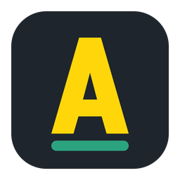
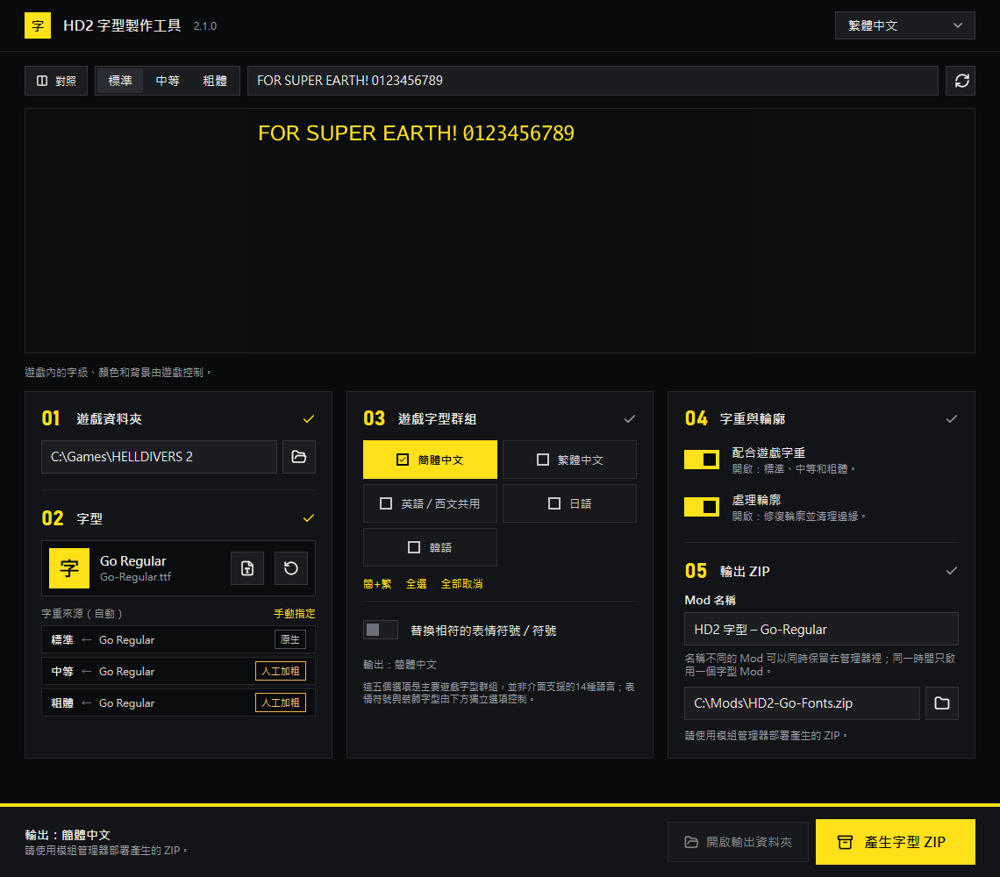

<p align="center"><a href="README.md">简体中文</a> | <a href="README.zh-TW.md">繁體中文</a> | <a href="README.ja.md">日本語</a> | <strong>한국어</strong> | <a href="README.en.md">English</a></p>

<p align="center">
  
</p>

<h1 align="center">HD2 Font Maker</h1>

<p align="center">
  가지고 있는 글꼴로 헬다이버즈 2 글꼴 교체 모드를 만듭니다.<br>
  Windows 네이티브 프로그램 · 인터페이스 언어 14종 · Python 불필요
</p>

<p align="center">
  <a href="https://github.com/cainiao524/hd2-font-maker-go/releases/latest"></a>
  <a href="LICENSE"></a>
  
</p>

<p align="center">
  
</p>

## 다운로드

[Releases 최신 버전](https://github.com/cainiao524/hd2-font-maker-go/releases/latest)에서 `HD2-Font-Maker-<版本>-Windows.zip`(약 14 MB)을 받습니다. `<版本>`는 버전 번호입니다.

- 폴더 전체를 게임 디렉터리 밖, 쓸 수 있는 위치에 푼 다음 `HD2FontMaker.exe`를 실행합니다.
- EXE와 같은 폴더의 DLL과 `vendor` 폴더는 그대로 두세요.
- Python, Go, WebView는 설치하지 않아도 됩니다.

2.2.5는 빌드 도구 모음을 Go 1.27.4(2026-11-10 보안 릴리스)로, 인터페이스 프레임워크를 MyGo 0.9.1로 업데이트했습니다. 굵기, 윤곽선, 아틀라스 매개변수, 패키징 규칙은 바뀌지 않았으므로, 이미 있는 글꼴 모드는 이번 업그레이드 때문에 다시 만들 필요가 없습니다. 창이 포커스를 잃어도 노란색 강조색은 유지됩니다. 생성하는 동안 단계 영역은 한 묶음으로 흐려집니다. 게임 내 표시는 아직 검증하지 않았습니다.

2.2.4는 글꼴 파일을 손으로 여러 개 고르거나, 여러 파일을 한꺼번에 끌어 놓을 수 있습니다. 같은 패밀리의 굵기는 고른 파일 안에서만 맞춥니다. 파일 목록과 수동 지정은 설정과 함께 저장되며, 다시 시작하면 복원됩니다. 파일을 하나만 다시 고르면 이전 묶음은 지워집니다. 같은 디렉터리 자동 검사는 계속 꺼져 있습니다. 2.2.3의 완화된 굵게 보정은 유지합니다.

2.2.3은 같은 디렉터리의 글꼴 자동 검사를 없앴습니다. 고른 파일만 가져오며, 이전 설정에 남아 있던 외부 글꼴은 불러올 때 정리됩니다. TTC／OTC 컬렉션 안의 굵기는 계속 자동으로 맞춥니다. 이름을 바꾼 사본이 여러 굵기 모드로 잘못 들어가던 문제를 고치고, 합성 굵게의 강도를 낮춰 작은 크기에서 획이 붙는 것을 완화했습니다. 보정을 적용하려면 글꼴 모드를 다시 만들어야 합니다.

2.2.2는 「가져온 글꼴 굵기」를 더했습니다. 정적 글꼴이 하나일 때는 기본적으로 중간(500)으로 두고, 가는 굵기와 굵게를 자동으로 만듭니다. 기본(400)을 골라 굵기를 더해 중간과 굵게를 만들거나, 굵게(700)를 고를 수도 있습니다. 기준으로 고른 값은 글꼴과 함께 저장되고, 각 단계는 가져온 글꼴에서 독립적으로 만들어집니다. 글꼴 컬렉션 안에 같은 패밀리의 기본, 중간, 굵게 서체가 이미 있으면 해당하는 서체를 자동으로 맞춥니다. MyGo 0.7.4와 Go 1.27.3으로도 함께 업데이트했습니다. 보정을 적용하려면 글꼴 모드를 다시 만들어야 합니다. 이미 쓰는 사람은 `UserData`를 남겨 둘 수 있습니다. 2.2.1의 글리프 단위 실패 폴백과 개수 집계는 유지합니다.

2.1.2는 생성 진행률이 계속 “—%”로 표시되던 문제를 고쳤습니다. 전체 진행률은 단계별 완료량에 따라 나아가며, ZIP 검증이 성공한 뒤에야 100%가 됩니다. 이미 쓰는 사람은 `UserData`를 남겨 둘 수 있습니다.

2.1.1은 같은 패밀리에서 빠진 글자를 채운 아틀라스가 글꼴 파일의 출처와 어긋나던 문제와, 글꼴을 다시 가져오거나 캐시에서 복원할 때 패밀리와 수동 굵기가 사라지던 문제를 고쳤습니다. 이미 쓰는 사람은 `UserData`를 남겨 둘 수 있습니다. 이전 설정이 가변 글꼴의 같은 패밀리 구성원을 잘못 넣었다면, 원래 디렉터리에서 글꼴을 한 번 다시 가져오세요. 아틀라스 수정은 글꼴 모드를 다시 만들어야 적용됩니다.

## 사용 방법

1. 헬다이버즈 2(Helldivers 2) 설치 디렉터리, 또는 그 `data` 폴더를 선택합니다.
2. TTF, OTF, TTC, OTC 글꼴을 고르거나 그대로 끌어 놓습니다. Ctrl／Shift 다중 선택과, 여러 파일을 한꺼번에 끌어 놓기를 지원합니다. 같은 패밀리의 굵기는 고른 파일 안에서만 맞추며, 같은 디렉터리의 다른 글꼴은 검사하지 않습니다. 글꼴 컬렉션 안에서는 자동으로 맞추거나, 특정 서체를 고를 수 있습니다.
3. 바꿀 게임 글꼴 그룹을 고릅니다. 서양 문자, 중국어 간체, 중국어 번체, 일본어, 한국어입니다. 필요하면 이모지와 특수 기호를 더합니다.
4. 「게임 글꼴 굵기에 맞추기」와 「윤곽선 처리」는 필요할 때 켜거나 끕니다. 글꼴이 하나이면 「가져온 글꼴 굵기」에서 원본 글꼴에 해당하는 굵기를 고릅니다. 기본값은 중간입니다. 가는 서체만 있으면 「기본 (400)」을 고릅니다. 고른 파일과 컬렉션 안의 같은 패밀리 굵기는 자동으로 맞으며, 줄마다 출처를 직접 지정할 수도 있습니다. 위쪽에서는 미리 볼 굵기를 바꾸고, 게임 원본 글꼴과 나란히 볼 수 있습니다.
5. 모드 이름과 출력 ZIP을 입력하고 「글꼴 ZIP 생성」을 누릅니다. 기본 이름은 글꼴 패밀리를 따르며, 직접 고친 뒤에는 그 이름이 유지됩니다. 아래쪽에는 생성 전에 아직 필요한 항목이 나열됩니다.
6. 만든 ZIP은 모드 관리자로 설치합니다.

프로그램은 고른 게임 디렉터리만 읽습니다. 게임을 실행하거나 코드를 주입하거나 게임을 수정하지 않으며, 모드를 자동으로 설치하지도 않습니다. 인터페이스 언어는 화면만 바꾸며, 만들어지는 내용은 바꾸지 않습니다.

## 기능

- **전체 교체**: 원본 글꼴의 문자 집합을 그대로 두며, 간체와 번체를 섞어 쓸 수 있습니다. 같은 패밀리의 여러 굵기에서는 다른 선택 서체에서 빠진 글자를 먼저 채우고, 그다음 게임 원본 글꼴로 폴백합니다.
- **굵기 맞추기**: 고른 파일이나 컬렉션 안에 같은 패밀리 서체가 여러 개 있으면, 해당하는 원래 굵기를 자동으로 고릅니다. 그래도 부족한 굵기 차이만 합성 굵게로 메웁니다. 가변 글꼴은 자신의 굵기 축을 씁니다. 정적 글꼴이 하나일 때는 기본적으로 중간(500)이며, 기본(400)이나 굵게(700)를 직접 고를 수 있습니다. 고른 단계는 있는 그대로 쓰고, 나머지 단계는 자동으로 만듭니다. 특정 줄을 수동으로 원본 그대로 되돌릴 수도 있습니다.
- **윤곽선 처리**: 윤곽선을 고치고 가장자리를 정리합니다. 굵기 맞추기와 따로 켜고 끕니다.
- **형식 유지**: 대상 글꼴의 TTF/CFF 형식, 글꼴 단위(UPM), 게임 원본 글꼴의 패밀리와 스타일 등록을 유지합니다.
- **아틀라스 출력**: RGBA MTSDF 아틀라스와 모든 밉 레벨을 만듭니다.
- **네이티브 구성**: Go 엔진과 [MyGo](https://github.com/egoist/mygo) 네이티브 인터페이스입니다. Skia, HarfBuzz, msdf-atlas-gen이 패키지에 함께 들어 있습니다.
- **화면**: 어두운 색과 노란색 강조색으로 고정되어 있습니다. 나란히 보는 미리 보기, 창 너비에 따라 1열에서 3열로 바뀌는 배치, 생성 진행률, 완료 패널이 있으며, 인터페이스 언어는 14종입니다.
- **모드 이름**: 이름은 생성되는 패키지를 구분하는 데 쓰입니다. 이름이 다르면 관리자 안에 따로 남겨 둘 수 있습니다. 같은 리소스를 바꾸는 글꼴 모드는 한 번에 하나만 켜야 합니다.

## 주의 사항

- 2.2.5는 아직 게임 내에서 시험하지 않았습니다. 글꼴 하나의 굵기 맞추기 결과는, 의도적으로 2.0.0과 바이트 단위로 같지 않습니다. 이전의 2.0.0은 게임 버전 01.007.200의 중국어 간체, 중국어 번체, 일본어 화면에서 표시가 정상임을 확인했습니다. 그 결과는 2.2.5를 가리키지 않습니다. 이 버전은 글꼴 엔진 문제를 고치지 않았습니다. 안전하게 폴백할 수 없는 글꼴 구조 오류는 계속 실패합니다. 글리프 하나의 네이티브 윤곽선 연산이 실패하면, 2.2.1과 같이 그 글리프만 폴백한 뒤 계속합니다.
- 합성 굵기가 글리프 하나의 네이티브 윤곽선 연산 오류를 만나면, 그 글리프를 폴백하고 생성을 계속합니다. 글꼴 테이블, 글리프 인코딩, 또는 파일 전체를 안전하게 폴백할 수 없으면 여전히 실패로 보고합니다.
- 글꼴 저작권은 원작자에게 있습니다. 사용할 권리가 있는 글꼴만 쓰고, 만든 모드는 그 라이선스에 따라 공유하세요.
- 배포 패키지와 소스에는 개인 글꼴, 게임 글꼴, 게임 리소스, 미리 만든 글꼴 모드가 들어 있지 않습니다.

## 검증

검증 기록은 중국어 간체로 되어 있습니다.

2.2.5의 도구 모음 및 MyGo 업그레이드와, 아직 검증하지 않은 게임 내 표시는 [VALIDATION-2.2.5.zh-CN.txt](VALIDATION-2.2.5.zh-CN.txt)에 있습니다.

2.2.4의 여러 파일 가져오기, 여러 파일 끌어 놓기, 다시 시작한 뒤의 복원, 네이티브 굵기 미리 보기 검증은 [VALIDATION-2.2.4.zh-CN.txt](VALIDATION-2.2.4.zh-CN.txt)에 있습니다.

2.2.3의 가져오기 범위, 옛 설정 마이그레이션, 완화된 굵게, 네이티브 생성 검증은 [VALIDATION-2.2.3.zh-CN.txt](VALIDATION-2.2.3.zh-CN.txt)에 있습니다.

2.2.2의 글꼴 하나 기준 선택, 컬렉션 자동 맞춤, MyGo 업그레이드, 미리 보기／생성 회귀 검증은 [VALIDATION-2.2.2.zh-CN.txt](VALIDATION-2.2.2.zh-CN.txt)에 있습니다. 2.2.1의 합성 굵기 폴백, Windows 빌드, 끝내지 못한 게임 내 검증은 [VALIDATION-2.2.1.zh-CN.txt](VALIDATION-2.2.1.zh-CN.txt)에 있습니다. 2.2.0의 글꼴 하나 굵기 변경, 얇게 만들기 폴백, 끝내지 못한 Windows／게임 내 검증은 [VALIDATION-2.2.0.zh-CN.txt](VALIDATION-2.2.0.zh-CN.txt)에 있습니다.

2.1.2의 진행률 회귀, 실제 리소스로 생성, 소스 패키지 다시 빌드, 검증 범위는 [VALIDATION-2.1.2.zh-CN.txt](VALIDATION-2.1.2.zh-CN.txt)에 있습니다.

2.1.1의 같은 패밀리 글꼴 회귀, 네이티브 아틀라스 생성, 소스 패키지 다시 빌드, 검증하지 않은 항목은 [VALIDATION-2.1.1.zh-CN.txt](VALIDATION-2.1.1.zh-CN.txt)에 있습니다. 2.1.0의 글꼴 하나 호환성 비교 등 이전 기록은 [VALIDATION-2.1.0.zh-CN.txt](VALIDATION-2.1.0.zh-CN.txt)에 있습니다.

원래 1.3 구현(프런트엔드 1.3.0 / 엔진 1.3.7)과 비교하면, 시험용 글꼴 두 벌의 출력에서 아틀라스 13장의 모든 밉 레벨이 바이트 단위로 같습니다. shaping, 글리프 기하, advance, cmap 비교에도 차이가 없습니다.

<details>
<summary>1.3.0-go.1 기준선 검증 상세</summary>

마지막 콜드 생성에서는 이미 만든 결과 캐시를 쓰지 않았습니다. 주요 글꼴 다섯 그룹과 기호를 모두 켜고, 굵기 맞추기와 윤곽선 처리도 모두 켰습니다. 시험 글꼴 A는 66.961초, 시험 글꼴 B는 114.517초가 걸렸습니다. 위 시간은 이 컴퓨터에서 한 번 잰 값이며, 통계적 기준이 아닙니다. 글꼴 가져오기와 게임 글꼴 목록의 첫 검사는 포함하지 않습니다.

출력 각각은 아틀라스 13장을 담으며, 모든 밉 레벨이 1.3 원 구현과 바이트 단위로 같습니다. 출력 한 벌의 아틀라스 GPU 부하는 합계 약 448 MiB이고, 한 장의 최대 크기는 4096×2048입니다.

출력 각각은 shaping 검사 1,360회와 emitted geometry 쌍 검사 1,972건을 통과했습니다. advance 차이는 0이고, cmap에서 빠지거나 더해진 항목도 모두 0입니다.

전체 글꼴 감사: 시험 글꼴 A와 B는 각각 리소스 슬롯 36개, 중복을 뺀 글꼴 17쌍을 다루었고, codepoint 1,957,145개와 2,109,193개를 검사했습니다. 빈 기록을 정밀하게 다시 확인한 뒤, 해결되지 않은 의미 항목은 없습니다.

1.3의 CFF 출력은, 이미 잉크가 있는 일부 글리프에 그리기 명령이 없는 빈 move/close 윤곽을 더 넣습니다. Go 출력은 이 빈 윤곽을 뺄 수 있습니다. 독립 재검토가 받아들이는 인코딩 차이는 이것뿐입니다. 닫힌 변을 정규화한 뒤, 나머지 그리기 명령은 모두 완전히 같습니다. 그린 변이 있는 면적 0인 경로, 윤곽 방향 또는 signed area의 변화는 계속 실패로 처리합니다. GID, 테이블 압축 방식, 글꼴 바이너리 배치, metadata는 달라도 됩니다. 글꼴 파일 자체는 바이트 단위로 같지 않습니다.

</details>

전체 기록: [VALIDATION-1.3.0-go.1.zh-CN.txt](VALIDATION-1.3.0-go.1.zh-CN.txt)(기준선), [VALIDATION.zh-CN.txt](VALIDATION.zh-CN.txt)(1.3.0-go.2의 중국어 경로 수정). 버전별 변경은 [Releases](https://github.com/cainiao524/hd2-font-maker-go/releases)에 있습니다.

## 소스에서 빌드

Windows x64가 필요합니다. 이 버전은 Go 1.27.4로 빌드하고 검증했습니다.

```powershell
.\build.ps1 -Go '<go.exe 路径>' -Test
```

스크립트는 MyGo 모듈 테스트를 실행하고 `native_go/mygoapp/bin/HD2FontMaker.exe`를 만든 뒤, `native_go/bin`의 네이티브 DLL과 루트 `vendor/`의 아틀라스 도구를 EXE 옆으로 복사합니다. `<go.exe 路径>`는 go.exe 경로로 바꾸면 됩니다. 전체 테스트는 `.\test.ps1 -Go '<go.exe 路径>'`로 실행합니다.

Windows 휴대용 패키지, 소스 패키지, SHA-256 목록을 이 컴퓨터에서 만들려면 `.\package.ps1 -Go '<go.exe 路径>'`를 씁니다. 기본적으로 전체 테스트를 먼저 실행합니다. 테스트를 방금 끝냈다면 `-SkipBuild`를 붙여 현재 빌드 결과를 다시 쓸 수 있습니다. 스크립트는 버전과 ZIP 내용을 계속 확인합니다. 출력은 `dist/`에 있습니다.

- `native_go/`: 글꼴 엔진(Go 모듈 `hd2font/native`).
- `native_go/mygoapp/`: MyGo 인터페이스(중첩 모듈). 인터페이스 번역은 `locales/`에 있습니다.
- 선택 사항인 Skia/HarfBuzz 네이티브 라이브러리 다시 빌드는 [native_go/SOURCE_BUILD.txt](native_go/SOURCE_BUILD.txt)를 보세요.

## English

HD2 Font Maker builds a Helldivers 2 font replacement mod from a font you supply. It is a native Windows app (Go engine, MyGo UI, 14 interface languages) that reads the game folder read-only and writes a ZIP for your mod manager. Download published Windows builds from [Releases](https://github.com/cainiao524/hd2-font-maker-go/releases/latest); build from source with `.\build.ps1 -Go '<path-to-go.exe>' -Test`. Version 2.2.5 updates the toolchain to Go 1.27.4 (security release, 2026-11-10) and the UI framework to MyGo 0.9.1. Weight synthesis, outline processing, atlas parameters and packaging rules are unchanged, so an existing font mod does not need to be regenerated for this upgrade. The window keeps its yellow accent when inactive. While a mod is generating, the steps fade as one group. Selecting or dropping multiple files still matches compatible weights only within that explicit selection. The selection and manual assignments survive restarts. Importing one file replaces the previous batch. Neighboring files are never scanned; internal TTC/OTC faces still match automatically. Synthetic emphasis stays at the gentler 2.2.3 curve, and identical copies do not trigger family-based extra bolding. The app defaults lone static fonts to Medium (500), with a saved choice of Regular (400), Medium (500), or Bold (700). Collections with native Regular, Medium and Bold faces match automatically. In-game rendering has not been verified. Per-glyph fallback for a native path failure is unchanged from 2.2.1; a font structure that cannot fall back safely still fails the build. Single-font output remains intentionally different from 2.0.0.

## 라이선스

이 프로젝트 자체의 코드는 [MIT 라이선스](LICENSE)입니다. 서드파티 구성 요소는 각자의 라이선스와 표기를 유지합니다. [native_go/THIRD-PARTY-NOTICES.txt](native_go/THIRD-PARTY-NOTICES.txt)와 [native_go/LICENSES](native_go/LICENSES)를 보세요.

다른 언어판은 이 파일과 같은 디렉터리에 있습니다. 이 페이지를 고칠 때는 `README.md`, `README.zh-TW.md`, `README.ja.md`, `README.ko.md`, `README.en.md`를 함께 수정하세요.
