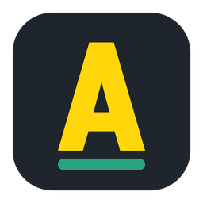
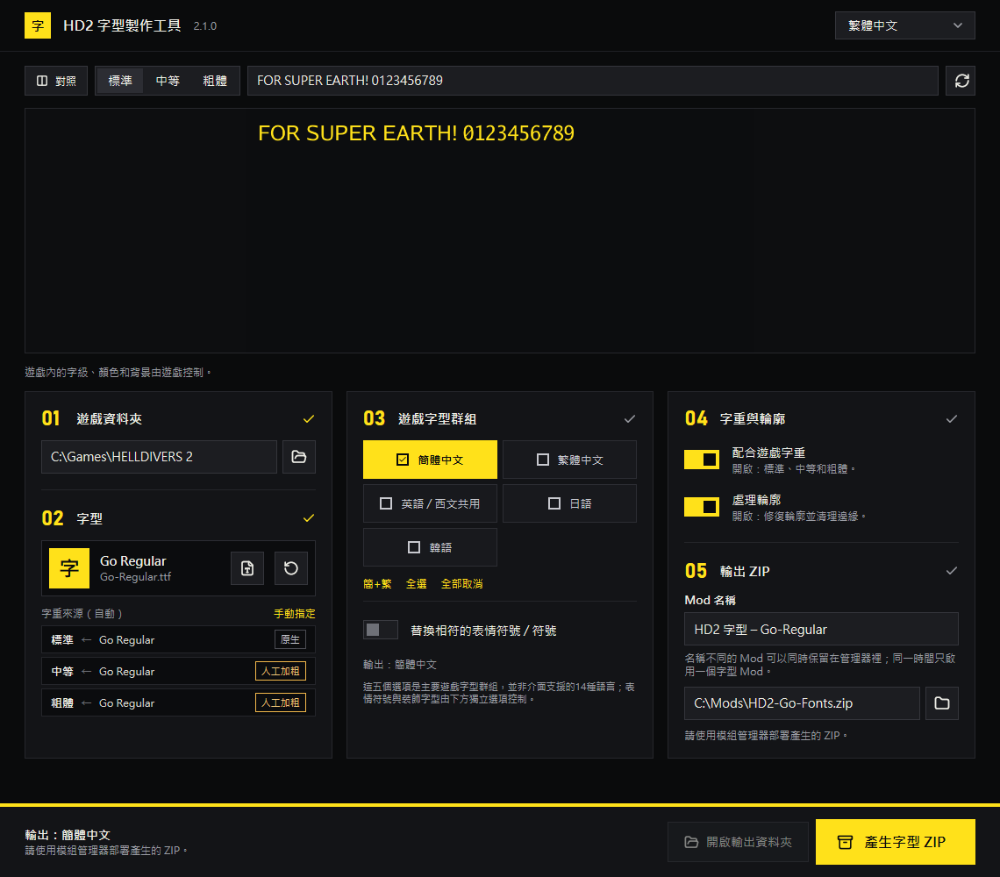

<p align="center">
  
</p>

<h1 align="center">HD2 Font Maker</h1>

<p align="center">
  用你自己的字体，生成 Helldivers 2 字体替换 Mod。<br>
  Windows 原生程序 · 14 种界面语言 · 无需 Python
</p>

<p align="center">
  <a href="https://github.com/cainiao524/hd2-font-maker-go/releases/latest"></a>
  <a href="LICENSE"></a>
  
</p>

<p align="center">
  
</p>

## 下载

从 [Releases 最新版](https://github.com/cainiao524/hd2-font-maker-go/releases/latest) 下载 `HD2-Font-Maker-<版本>-Windows.zip`（约 14 MB）。

- 将整个文件夹解压到游戏目录以外的可写位置，运行 `HD2FontMaker.exe`。
- 请保留 EXE 同目录的 DLL 和 `vendor` 文件夹。
- 不需要安装 Python、Go 或 WebView。

## 使用

1. 选择 Helldivers 2 安装目录或其 `data` 文件夹。
2. 选择或直接拖入 TTF、OTF、TTC、OTC 字体；字体集合可选择具体字面。
3. 选择要替换的游戏字体组：西文、简中、繁中、日文、韩文，按需加选表情和特殊符号。
4. 按需开关「匹配游戏字重」和「处理轮廓」。
5. 选择输出 ZIP，点击「生成字体 ZIP」。底部会列出生成前仍缺少的步骤。
6. 用 Mod 管理器安装生成的 ZIP。

程序只读取所选游戏目录，不会启动、注入或修改游戏，也不会自动安装 Mod。界面语言只影响界面，不改变生成内容。

## 功能

- **完整替换**：保留源字体的完整字符表；源字体缺字时，逐字回退到原游戏字体，支持简繁混排。
- **字重匹配**：生成常规、中等、粗体，保留字符宽度、字距和行距，不挤压排版。
- **轮廓处理**：修复轮廓、清理边缘，与字重匹配分别开关。
- **格式保持**：保留目标字体的 TTF/CFF 格式、字体单位（UPM）以及原游戏字体的家族和样式注册。
- **图集输出**：生成 RGBA MTSDF 图集及全部 mip 层级。
- **原生组件**：Go 引擎 + [MyGo](https://github.com/egoist/mygo) 原生界面；Skia、HarfBuzz、msdf-atlas-gen 随包提供。
- **界面**：分步流程、实时预览、拖放导入、跟随系统深浅色，支持 14 种界面语言。

## 注意事项

- 生成结果经过离线回读和比对验证。2.0.0 已在游戏版本 01.007.200 的简体中文、繁体中文、日文界面确认显示正常（重要指令页、设置菜单）；韩文界面以及任务内 HUD、字幕尚未核对，不同游戏版本的实际显示请自行核对。
- 字体版权归原作者所有，请只使用你有权使用的字体，并按其许可分享生成的 Mod。
- 发行包和源码不包含任何个人字体、游戏字体、游戏资源或预生成的字体 Mod。

## 验证

与原 1.3 实现（前端 1.3.0 / 引擎 1.3.7）对照：两套测试字体的输出，13 张图集的全部 mip 层级逐字节一致；shaping、字形几何、advance 与 cmap 比对均无差异。

<details>
<summary>1.3.0-go.1 基线验证详情</summary>

最终冷生成未使用已生成结果缓存；五组主字体与符号全开，字重匹配和轮廓处理均开启。测试字体 A 用时 66.961 秒，测试字体 B 用时 114.517 秒。以上为本机单次观测，不是统计基准；不含字体导入和首次扫描游戏库存。

两套输出各包含 13 张图集，全部 mip 层级与 1.3 原实现逐字节一致；每套输出的图集 GPU 负载合计约 448 MiB，单张最大 4096×2048。

两套输出各通过 1,360 次 shaping 检查和 1,972 对 emitted geometry 检查；advance 差异为 0，cmap 缺失和多余均为 0。

完整字体审计：测试字体 A 和 B 各自完成 36 个资源槽位、17 对去重字体，分别检查 1,957,145 和 2,109,193 个 codepoint；精确空记录复核后没有未解决的语义项。

1.3 的 CFF 输出在少数已有墨迹的字形中，额外包含没有绘制指令的空 move/close 轮廓；Go 输出可能省略这些空轮廓。独立复核只接受这一编码差异，并确认在归一化闭合边后，其余全部绘制命令完全一致；有绘制边的零面积路径、轮廓方向或 signed area 变化仍按失败处理。GID、表压缩方式、字体二进制布局和 metadata 可以不同，字体文件本身并非逐字节一致。

</details>

完整记录：[VALIDATION-1.3.0-go.1.zh-CN.txt](VALIDATION-1.3.0-go.1.zh-CN.txt)（基线）、[VALIDATION.zh-CN.txt](VALIDATION.zh-CN.txt)（1.3.0-go.2 中文路径修复）。各版本改动见 [Releases](https://github.com/cainiao524/hd2-font-maker-go/releases)。

## 从源码构建

需要 Windows x64 和 Go 1.27.2 或更新版本。

```powershell
.\build.ps1 -Go '<go.exe 路径>' -Test
```

脚本会运行 MyGo 模块测试，生成 `native_go/mygoapp/bin/HD2FontMaker.exe`，并把 `native_go/bin` 中的原生 DLL 和根目录 `vendor/` 中的图集工具复制到 EXE 旁边。运行全部测试用 `.\test.ps1 -Go '<go.exe 路径>'`。

- `native_go/`：字体引擎（Go 模块 `hd2font/native`）。
- `native_go/mygoapp/`：MyGo 界面（嵌套模块），界面翻译在 `locales/`。
- 可选的 Skia/HarfBuzz 原生库重建见 [native_go/SOURCE_BUILD.txt](native_go/SOURCE_BUILD.txt)。

## English

HD2 Font Maker builds a Helldivers 2 font replacement mod from a font you supply. It is a native Windows app (Go engine, MyGo UI, 14 interface languages) that reads the game folder read-only and writes a ZIP for your mod manager. Download the Windows build from [Releases](https://github.com/cainiao524/hd2-font-maker-go/releases/latest); build from source with `.\build.ps1 -Go '<path-to-go.exe>' -Test`.

## 许可

项目自有代码采用 [MIT 许可证](LICENSE)。第三方组件保留各自的许可证和署名，见 [native_go/THIRD-PARTY-NOTICES.txt](native_go/THIRD-PARTY-NOTICES.txt) 和 [native_go/LICENSES](native_go/LICENSES)。
