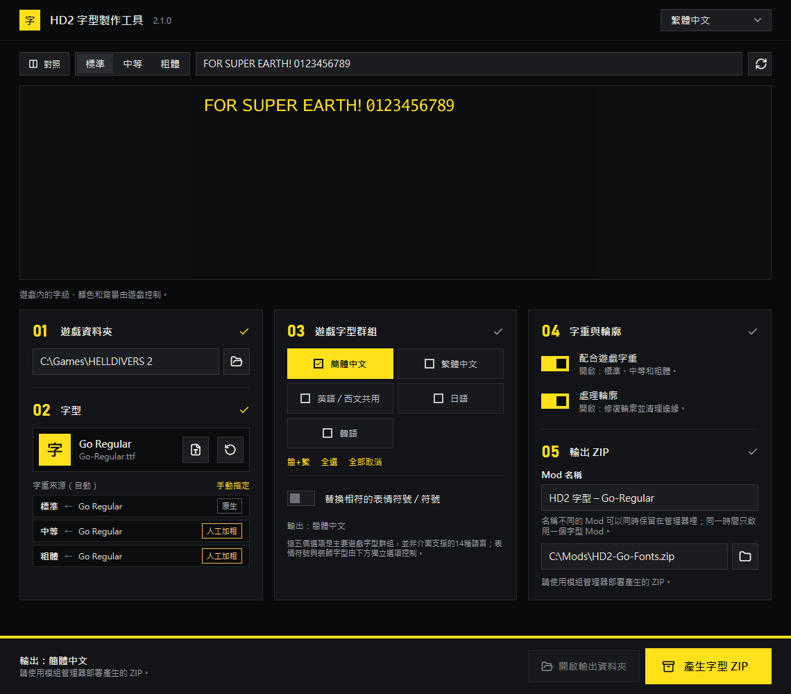

<p align="center"><a href="README.md">简体中文</a> | <strong>繁體中文</strong> | <a href="README.ja.md">日本語</a> | <a href="README.ko.md">한국어</a> | <a href="README.en.md">English</a></p>

<p align="center">
  
</p>

<h1 align="center">HD2 Font Maker</h1>

<p align="center">
  用你自己的字型，產生絕地戰兵2 的字型替換 Mod。<br>
  Windows 原生程式 · 14 種介面語言 · 不需要 Python
</p>

<p align="center">
  <a href="https://github.com/cainiao524/hd2-font-maker-go/releases/latest"></a>
  <a href="LICENSE"></a>
  
</p>

<p align="center">
  
</p>

## 下載

從 [Releases 最新版](https://github.com/cainiao524/hd2-font-maker-go/releases/latest) 下載 `HD2-Font-Maker-<版本>-Windows.zip`（約 14 MB）。`<版本>` 是版本號。

- 將整個資料夾解壓縮到遊戲目錄以外、可以寫入的位置，然後執行 `HD2FontMaker.exe`。
- 請保留 EXE 同目錄的 DLL 和 `vendor` 資料夾。
- 不需要安裝 Python、Go 或 WebView。

2.2.6 的預設預覽同時包含簡體中文、繁體中文、日文、韓文和英文標語，以及 `Player G4 - 0123456789`。其他介面語言仍把自己的標語放在最前。設定裡仍是舊預設範例的會自動換成新範例，自己改過的文字保持不變。說明文件提供簡體中文、繁體中文、日文、韓文和英文。字型產生規則沒有改動。這一版沒有在真實 Windows 上執行，也沒有用包含中日韓字形的字型驗證預覽。遊戲內顯示仍未驗證。

2.2.5 將建置工具鏈更新到 Go 1.27.4（2026-11-10 的安全性版本），介面框架更新到 MyGo 0.9.1。字重、輪廓、圖集參數和打包規則沒有改動，既有的字型 Mod 不必為了這次升級重新產生。視窗失焦時仍保持黃色強調色。產生過程中，步驟區域會整組變淡。遊戲內顯示仍未驗證。

2.2.4 支援手動多選，或一次拖入多個字型檔。同家族字重只從所選檔案中匹配。檔案清單和手動指定會隨設定儲存，重新啟動後可以還原。重新只選一個檔案會清除上一批檔案。同目錄自動掃描維持關閉。2.2.3 的溫和加粗修正仍然保留。

2.2.3 取消同目錄字型的自動掃描：只匯入選取的檔案，舊設定裡的外部字型會在載入時清理。TTC／OTC 集合內部的字重仍會自動匹配。修正了重新命名的副本誤入多字重模式，並降低合成加粗的幅度，減輕小字級的筆畫黏連。要套用這項修正，需要重新產生字型 Mod。

2.2.2 新增「匯入字型作為」：單一靜態字型預設當作中等（500），並自動產生細體和粗體；也可以選擇細體／標準（400），以自動加粗產生中等和粗體，或選擇粗體（700）。基準的選擇會隨字型儲存，各個檔位都從匯入的字型獨立產生。字型集合裡如果已經有同家族的標準、中等、粗體，會自動匹配到對應字面。同時更新到 MyGo 0.7.4 與 Go 1.27.3。必須重新產生字型 Mod，修正才會套用；既有使用者可以保留 `UserData`。2.2.1 的單一字形失敗回退與計數仍然保留。

2.1.2 修正產生進度一直顯示“—%”的問題。整體進度依各階段的完成量推進，ZIP 驗證成功後才會到 100%。既有使用者可以保留 `UserData`。

2.1.1 修正同家族補字圖集與字型檔來源不一致，以及重新匯入字型、從快取還原時，家族和手動字重遺失的問題。既有使用者可以保留 `UserData`。如果舊設定誤加了可變字型的同家族成員，請從原目錄再匯入一次字型。圖集的修正要重新產生字型 Mod 才會生效。

## 使用

1. 選取絕地戰兵2（Helldivers 2）的安裝目錄，或其 `data` 資料夾。
2. 選取或直接拖入 TTF、OTF、TTC、OTC 字型。可用 Ctrl／Shift 多選，或一次拖入多個檔案。同家族字重只從所選檔案匹配，不會掃描同目錄的其他字型；字型集合內部也可以自動匹配，或指定具體字面。
3. 選擇要替換的遊戲字型組：西文、簡中、繁中、日文、韓文，需要時再加選表情和特殊符號。
4. 依需要開關「配合遊戲字重」和「處理輪廓」。單一字型請在「匯入字型作為」選擇原字型對應的字重，預設為中等；只有細體時，選擇「細體 / 標準 (400)」。所選檔案和集合內部的同家族字重會自動匹配，也可以逐列手動指定來源。頂端可以切換預覽字重，並與原版字型對照。
5. 填寫 Mod 名稱和輸出 ZIP，點選「產生字型 ZIP」。預設名稱跟隨字型家族，手動改過之後會保留；底部會列出產生前仍然缺少的步驟。
6. 用模組管理器安裝產生的 ZIP。

程式只讀取所選的遊戲目錄，不會啟動、注入或修改遊戲，也不會自動安裝 Mod。介面語言只影響介面，不會改變產生的內容。

## 功能

- **完整替換**：保留來源字型的完整字元表，支援簡繁混排；同家族多字重模式會先用其他已選字面補上缺字，再回退到遊戲原有字型。
- **字重匹配**：所選檔案或集合內若有同家族的多個字面，會自動選用對應的原生字重，只對仍然不足的字重差距做合成加粗；可變字型使用自己的字重軸。單一靜態字型預設當作中等（500），也可以自選標準（400）或粗體（700）。選中的檔位依原樣使用，其餘檔位自動產生；也可以手動把某一列改回原樣。
- **輪廓處理**：修復輪廓、清理邊緣，與字重匹配各自開關。
- **格式保持**：保留目標字型的 TTF/CFF 格式、字型單位（UPM），以及遊戲原有字型的家族與樣式註冊。
- **圖集輸出**：產生 RGBA MTSDF 圖集和全部 mip 層級。
- **原生元件**：Go 引擎 + [MyGo](https://github.com/egoist/mygo) 原生介面；Skia、HarfBuzz、msdf-atlas-gen 隨套件提供。
- **介面**：固定為深色與黃色強調色，提供對照預覽、可隨視窗寬度在一到三欄之間切換的版面、產生進度與完成面板，並支援 14 種介面語言。
- **Mod 名稱**：名稱會計入產生套件的識別。不同名稱可以在管理器裡分別保留；同一時間仍應只啟用一套替換相同資源的字型 Mod。

## 注意事項

- 2.2.6 尚未進行遊戲內測試，也沒有在真實 Windows 桌面上執行。預覽中的中日韓文字沒有用包含這些字形的字型驗證。單一字型的字重匹配輸出，是刻意不再與 2.0.0 逐位元組一致。過去的 2.0.0 曾在遊戲版本 01.007.200 的簡體中文、繁體中文、日文介面確認顯示正常；那項結果並不代表 2.2.6。這一版沒有修復字型引擎的問題：無法安全回退的字型結構錯誤仍會失敗，單一字形的原生輪廓運算失敗時，仍依 2.2.1 回退該字形並繼續。
- 合成字重若在單一字形遇到原生輪廓運算錯誤，會回退該字形並繼續產生；如果字型表、字形編碼或整個檔案無法安全回退，仍會回報失敗。
- 字型著作權屬於原作者。請只使用你有權使用的字型，並依照其授權分享產生的 Mod。
- 發行套件和原始碼不包含任何個人字型、遊戲字型、遊戲資源，或預先產生的字型 Mod。

## 驗證

驗證紀錄為簡體中文。

2.2.6 的多語言預覽範例、說明文件，以及尚未驗證的真實 Windows 和遊戲內顯示，見 [VALIDATION-2.2.6.zh-CN.txt](VALIDATION-2.2.6.zh-CN.txt)。

2.2.5 的工具鏈與 MyGo 升級，以及尚未驗證的遊戲內顯示，見 [VALIDATION-2.2.5.zh-CN.txt](VALIDATION-2.2.5.zh-CN.txt)。

2.2.4 的多選匯入、多檔拖放、重新啟動後還原，以及原生字重預覽驗證，見 [VALIDATION-2.2.4.zh-CN.txt](VALIDATION-2.2.4.zh-CN.txt)。

2.2.3 的匯入範圍、舊設定遷移、溫和加粗和原生產生驗證，見 [VALIDATION-2.2.3.zh-CN.txt](VALIDATION-2.2.3.zh-CN.txt)。

2.2.2 的單一字型基準選擇、集合自動匹配、MyGo 升級，以及預覽／產生的回歸驗證，見 [VALIDATION-2.2.2.zh-CN.txt](VALIDATION-2.2.2.zh-CN.txt)。2.2.1 的合成字重回退、Windows 建置，以及尚未完成的遊戲內驗證，見 [VALIDATION-2.2.1.zh-CN.txt](VALIDATION-2.2.1.zh-CN.txt)。2.2.0 的單一字型字重改動、變細回退，以及尚未完成的 Windows／遊戲內驗證，見 [VALIDATION-2.2.0.zh-CN.txt](VALIDATION-2.2.0.zh-CN.txt)。

2.1.2 的進度回歸、以真實資源產生、原始碼套件重建和驗證邊界，見 [VALIDATION-2.1.2.zh-CN.txt](VALIDATION-2.1.2.zh-CN.txt)。

2.1.1 的同家族字型回歸、原生圖集產生、原始碼套件重建與未驗證項目，見 [VALIDATION-2.1.1.zh-CN.txt](VALIDATION-2.1.1.zh-CN.txt)。2.1.0 的單一字型相容性比對等歷史紀錄，見 [VALIDATION-2.1.0.zh-CN.txt](VALIDATION-2.1.0.zh-CN.txt)。

與原來的 1.3 實作（前端 1.3.0／引擎 1.3.7）對照：兩套測試字型的輸出中，13 張圖集的全部 mip 層級逐位元組一致；shaping、字形幾何、advance 與 cmap 的比對都沒有差異。

<details>
<summary>1.3.0-go.1 基線驗證詳情</summary>

最終的冷產生沒有使用已經產生的結果快取。五組主要字型與符號全部開啟，字重匹配和輪廓處理也都開啟。測試字型 A 花了 66.961 秒，測試字型 B 花了 114.517 秒。以上是這台電腦的單次觀察，不是統計基準；不包含字型匯入，以及第一次掃描遊戲字型庫存。

兩套輸出各含 13 張圖集，全部 mip 層級與 1.3 原實作逐位元組一致。每一套輸出的圖集 GPU 負載合計約 448 MiB，單張最大為 4096×2048。

兩套輸出各通過 1,360 次 shaping 檢查，以及 1,972 對 emitted geometry 檢查。advance 差異為 0，cmap 缺少和多餘的項目都是 0。

完整字型稽核：測試字型 A 和 B 各自完成 36 個資源槽位、17 對去重字型，分別檢查 1,957,145 和 2,109,193 個 codepoint。精確複核空紀錄之後，沒有尚未解決的語意項目。

1.3 的 CFF 輸出裡，少數已經有墨跡的字形另外包含沒有繪製指令的空白 move/close 輪廓；Go 輸出可能省略這些空白輪廓。獨立複核只接受這一項編碼差異，並確認在正規化閉合邊之後，其餘全部繪製命令完全一致。帶有繪製邊的零面積路徑，或輪廓方向、signed area 的變化，仍視為失敗。GID、表的壓縮方式、字型二進位布局和 metadata 可以不同，字型檔本身並非逐位元組一致。

</details>

完整紀錄：[VALIDATION-1.3.0-go.1.zh-CN.txt](VALIDATION-1.3.0-go.1.zh-CN.txt)（基線）、[VALIDATION.zh-CN.txt](VALIDATION.zh-CN.txt)（1.3.0-go.2 的中文路徑修復）。各版本的改動見 [Releases](https://github.com/cainiao524/hd2-font-maker-go/releases)。

## 從原始碼建置

需要 Windows x64。這一版使用 Go 1.27.4 建置和驗證。

```powershell
.\build.ps1 -Go '<go.exe 路径>' -Test
```

腳本會執行 MyGo 模組測試，產生 `native_go/mygoapp/bin/HD2FontMaker.exe`，並把 `native_go/bin` 裡的原生 DLL，以及根目錄 `vendor/` 裡的圖集工具，複製到 EXE 旁邊。`<go.exe 路径>` 是 go.exe 路徑的佔位文字。執行全部測試請用 `.\test.ps1 -Go '<go.exe 路径>'`。

在本機產生 Windows 可攜式套件、原始碼套件和 SHA-256 清單，請用 `.\package.ps1 -Go '<go.exe 路径>'`。預設會先執行完整測試。剛完成測試時可以加上 `-SkipBuild`，沿用現有的編譯結果；腳本仍會檢查版本和 ZIP 內容。輸出位於 `dist/`。

- `native_go/`：字型引擎（Go 模組 `hd2font/native`）。
- `native_go/mygoapp/`：MyGo 介面（巢狀模組），介面翻譯在 `locales/`。
- 可選的 Skia/HarfBuzz 原生程式庫重建，見 [native_go/SOURCE_BUILD.txt](native_go/SOURCE_BUILD.txt)。

## English

HD2 Font Maker builds a Helldivers 2 font replacement mod from a font you supply. It is a native Windows app (Go engine, MyGo UI, 14 interface languages) that reads the game folder read-only and writes a ZIP for your mod manager. Download published Windows builds from [Releases](https://github.com/cainiao524/hd2-font-maker-go/releases/latest); build from source with `.\build.ps1 -Go '<path-to-go.exe>' -Test`. Version 2.2.6 puts Simplified Chinese, Traditional Chinese, Japanese, Korean, and English in the default preview sample, keeps each other interface language's own slogan first, and replaces a saved copy of any previous default. Custom preview text is left unchanged. READMEs are published in those five languages. This build was not run on a real Windows desktop, and the CJK preview lines were not checked with a font that contains those outlines. Version 2.2.5 updates the toolchain to Go 1.27.4 (security release, 2026-11-10) and the UI framework to MyGo 0.9.1. Weight synthesis, outline processing, atlas parameters and packaging rules are unchanged, so an existing font mod does not need to be regenerated for this upgrade. The window keeps its yellow accent when inactive. While a mod is generating, the steps fade as one group. Selecting or dropping multiple files still matches compatible weights only within that explicit selection. The selection and manual assignments survive restarts. Importing one file replaces the previous batch. Neighboring files are never scanned; internal TTC/OTC faces still match automatically. Synthetic emphasis stays at the gentler 2.2.3 curve, and identical copies do not trigger family-based extra bolding. The app defaults lone static fonts to Medium (500), with a saved choice of Regular (400), Medium (500), or Bold (700). Collections with native Regular, Medium and Bold faces match automatically. In-game rendering has not been verified. Per-glyph fallback for a native path failure is unchanged from 2.2.1; a font structure that cannot fall back safely still fails the build. Single-font output remains intentionally different from 2.0.0.

## 授權

本專案自己的程式碼採用 [MIT 授權](LICENSE)。第三方元件保留各自的授權和署名，見 [native_go/THIRD-PARTY-NOTICES.txt](native_go/THIRD-PARTY-NOTICES.txt) 和 [native_go/LICENSES](native_go/LICENSES)。

其他語言版本與本檔放在同一目錄。更新本頁時，請一併修改 `README.md`、`README.zh-TW.md`、`README.ja.md`、`README.ko.md` 和 `README.en.md`。
